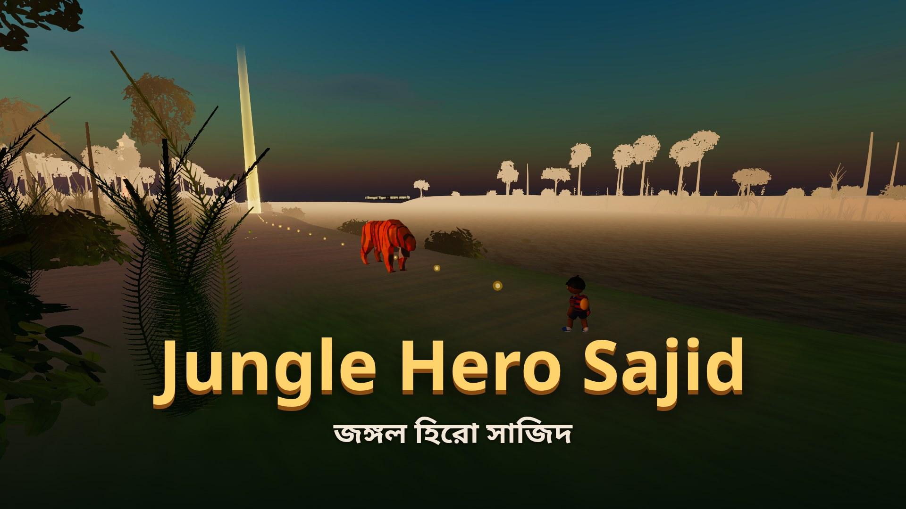
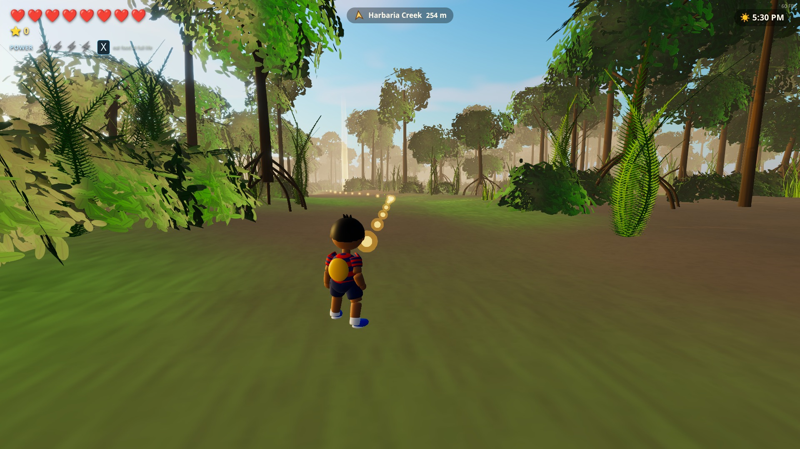
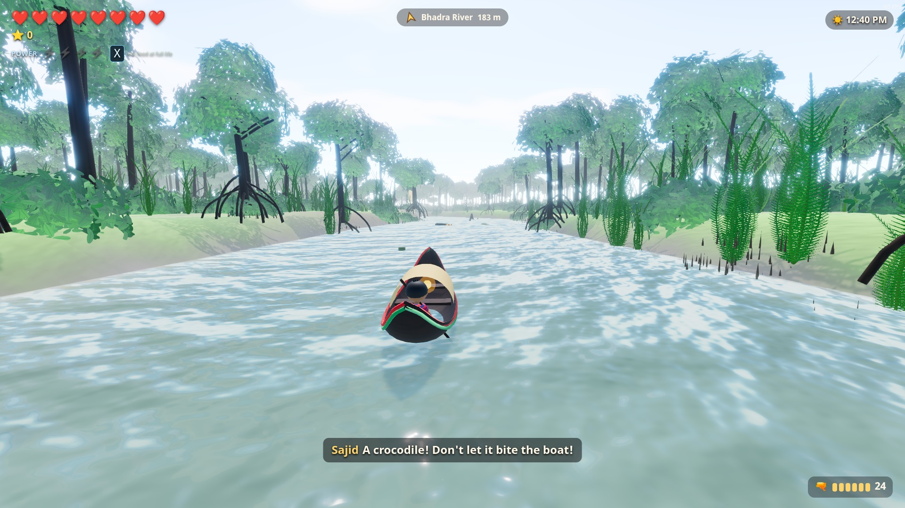
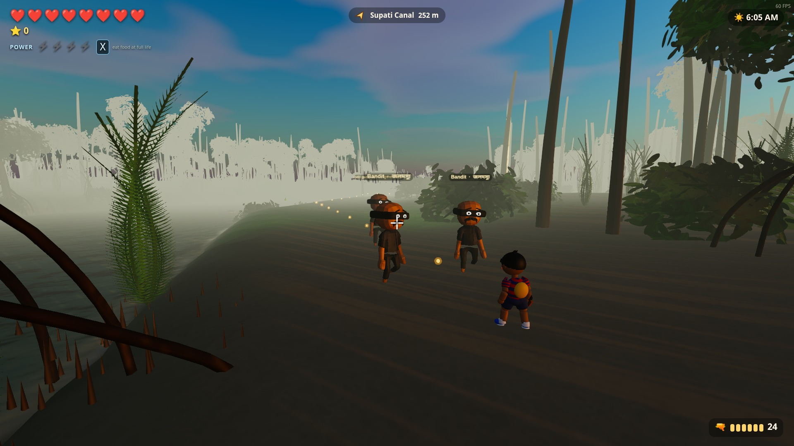
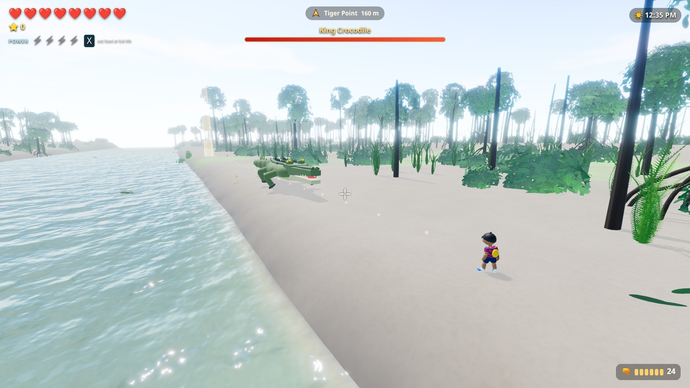
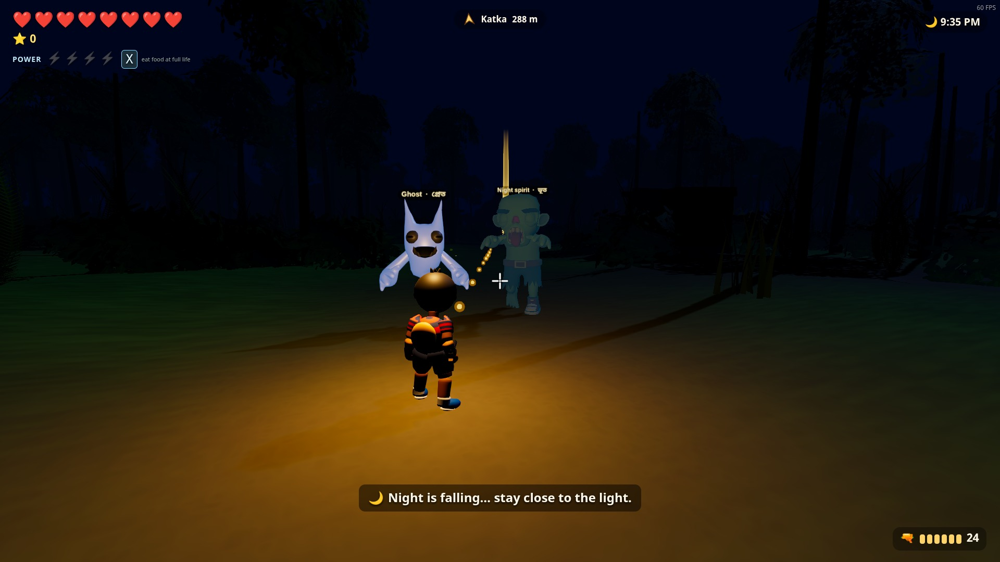
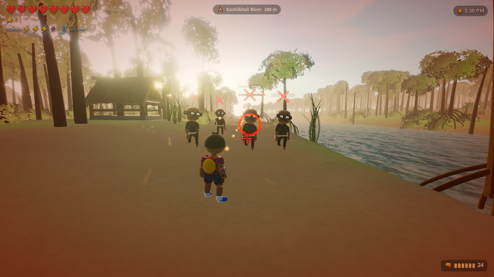
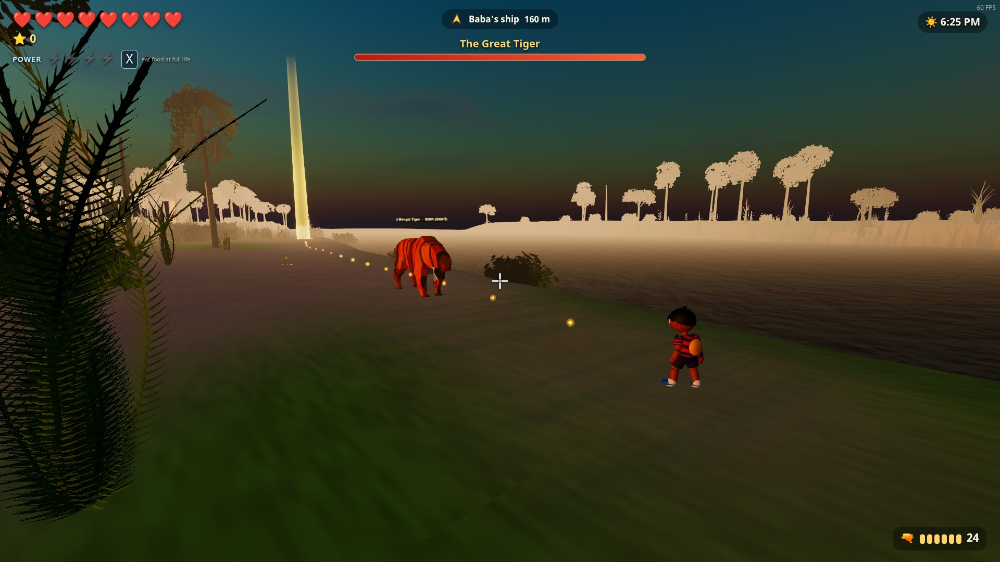
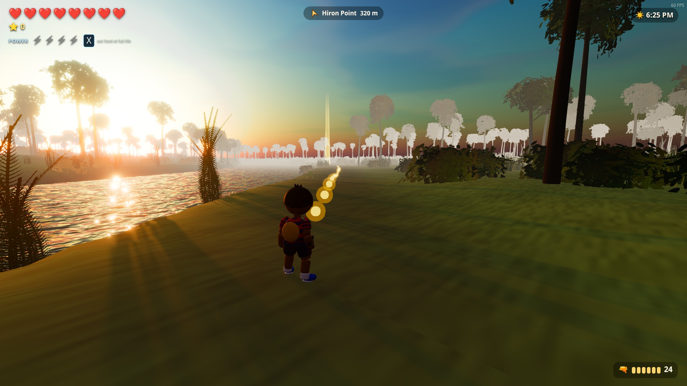

# Jungle Hero Sajid · জঙ্গল হিরো সাজিদ

**A 3D cartoon adventure in the Sundarbans.** Published by **[Abacus IT](https://abacusitbd.com)**, Dhaka, Bangladesh.

Five-year-old Sajid was on a ship trip through the Sundarbans with his Baba
(dad), Riad. On the forest walkway at Harbaria a storm came, a deer ran, and
Sajid ran after it. When he came back, the ship had gone, sailing on to Hiron
Point.

Help Sajid walk, swim and paddle his way through **20 levels of real places**
in the world's largest mangrove forest: Harbaria, the Pasur and Bhadra
rivers, Supati, Kachikhali's Tiger Point, Dimer Char, Katka and Jamtola beach,
Dublar Char, Nilkamal, all the way to Hiron Point, where Baba is waiting.

- Fists, a flying punch, dodge rolls and Baba's old revolver
- Power moves: a shockwave punch and a slow-motion "dead eye"
- Bandits, crocodiles that climb out of the river, wild boars, pythons, monkeys, kites and night ghosts
- Four bosses: the Giant Boar, the King Crocodile, the Bandit Leader and the Great Tiger
- Paddle a nouka through creeks; day and night, rain and storms
- Every word in English and Bangla; full controller support; fullscreen or windowed

পাঁচ বছরের সাজিদ তার বাবা রিয়াদের সাথে জাহাজে করে সুন্দরবন দেখতে গিয়েছিল।
হাড়বাড়িয়ায় ঝড়ের মধ্যে সে হারিয়ে যায়, আর জাহাজ চলে যায় হিরণ পয়েন্টে। ২০টি
আসল জায়গা পেরিয়ে সাজিদকে বাবার কাছে পৌঁছাতে সাহায্য করো।

## Download

**[Latest release →](https://github.com/riadul/jungle-hero-sajid-download/releases/latest)**

| Platform | How |
|---|---|
| **Windows 10/11** | `winget install AbacusIT.JungleHeroSajid`, or download `JungleHeroSajid-Setup-<version>-x64.exe` from the release. The installer isn't code-signed yet: if Windows SmartScreen appears, click **More info → Run anyway**. |
| **Ubuntu / Linux (Snap Store)** | [snapcraft.io/jungle-hero-sajid](https://snapcraft.io/jungle-hero-sajid), or `sudo snap install jungle-hero-sajid` |
| **Linux (any distro)** | `JungleHeroSajid-<version>-linux-x86_64.AppImage`: `chmod +x` it and run |
| **Ubuntu / Debian** | `sudo apt install ./jungle-hero-sajid_<version>_amd64.deb` |

**System requirements:** 64-bit Windows 10/11 or Linux; 4 GB RAM (8 GB
recommended); a graphics card with WebGL 2 (GTX 960 / RX 470 / Intel Iris Xe or
better); 600 MB disk.

## Screenshots

## Controls

WASD move · Shift run · Space jump (in a fight, Space + direction rolls) ·
right mouse aim · left mouse shoot / punch · Space then left mouse: flying
punch · Q fists ⇄ revolver · E pick up / eat / board the boat · X power ·
Esc pause (lists all controls) · F11 fullscreen. A gamepad works too.

## Privacy

The game collects no personal data and works offline:
[privacy policy](https://gist.github.com/riadul/7ed5a7fa24a668abc58d0dfa354aea6b).

## Contact

info@abacusitbd.com · https://abacusitbd.com

This repository only hosts the game's downloads. © 2026 Abacus IT. Free to
download and play; see [LICENSE.md](LICENSE.md).
